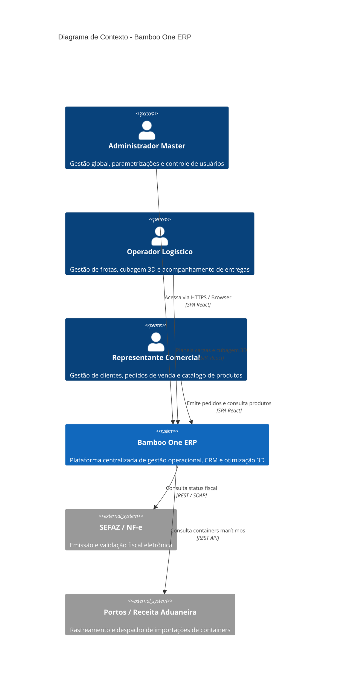
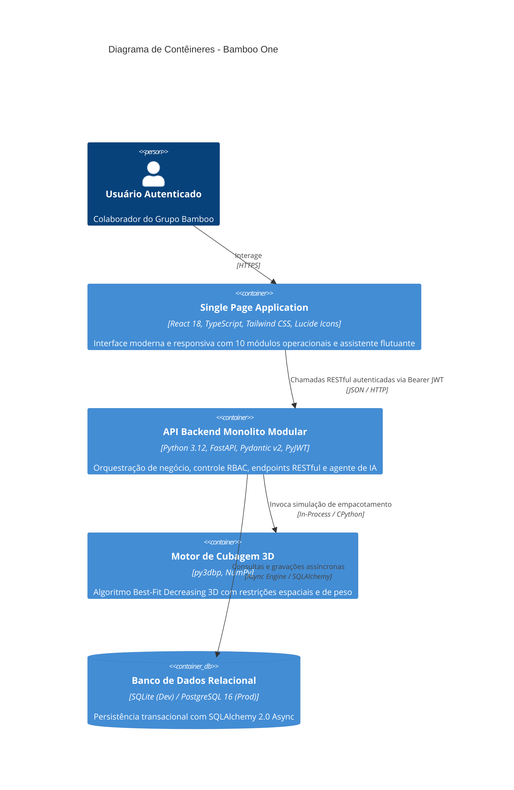

# Documento de Arquitetura de Software: Bamboo One ERP

## 1. Visão Geral e Propósito do Sistema
O **Bamboo One** é a plataforma unificada de gestão empresarial (ERP) e logística inteligente desenvolvida para o **Grupo Bamboo**. O projeto nasceu da necessidade de consolidar **5 sistemas legados heterogêneos** (CRM de Vendas, Compras/Importações, Controle de Estoque WMS, Gestão de Frota/Entregas e Financeiro/RH) em uma solução coesa, escalável, moderna e dotada de um **motor de inteligência logística 3D** para cubagem e carregamento de frotas.

---

## 2. Padrões de Arquitetura Adotados

### 2.1. Monolito Modular (Modular Monolith)
Em vez de adotar microsserviços precocemente — o que geraria complexidade operacional excessiva com latência de rede, consistência eventual e despesas com infraestrutura —, o sistema adota o padrão **Monolito Modular**:
- **Domínios Isolados**: Cada bounded context (módulo de negócio) reside em seu próprio diretório em `src/modules/`.
- **Comunicação por Contratos (Interfaces)**: Módulos expõem contratos limpos e não realizam acoplamento direto de tabelas alheias.
- **Deploy Unificado**: Único pipeline de CI/CD, executável em um único processo ou container Docker, com baixíssimo consumo de memória e latência mínima.
- **Fácil Migração Futura**: Caso um domínio de negócio (ex: motor 3D de cubagem) demande escalabilidade independente, sua estrutura interna já é desacoplada o suficiente para virar um microsserviço isolado sem reescrever o domínio.

### 2.2. Clean Architecture (Arquitetura Limpa em 4 Camadas)
Cada módulo do sistema segue estritamente a separação em camadas proposta por Robert C. Martin (Uncle Bob):

```
       +------------------------------------------------+
       |   Camada de Apresentação (Presentation)        |
       |   - FastAPI Routers, Pydantic Schemas, DTOs    |
       |   +--------------------------------------------+
       |   |   Camada de Aplicação (Application)        |
       |   |   - Casos de Uso (Use Cases / Services)    |
       |   |   - Interfaces / Portas (Repository Ports) |
       |   |   +----------------------------------------+
       |   |   |   Camada de Domínio (Domain Core)      |
       |   |   |   - Entidades Puras (Entities)         |
       |   |   |   - Objetos de Valor (Value Objects)   |
       |   |   |   - Regras de Negócio e Invariantes    |
       +---+---+---+------------------------------------+
       |   Camada de Infraestrutura (Infrastructure)    |
       |   - SQLAlchemy 2.0 Async ORM Models, Drivers   |
       |   - Repositórios Concretos, APIs Externas      |
       +------------------------------------------------+
```

1. **Domínio (Domain)**:
   - Contém entidades puras em Python (ex: `Product`, `Vehicle`, `BoxDimension`).
   - Não possui nenhuma dependência externa (nem SQLAlchemy, nem FastAPI, nem Pydantic).
   - Valida invariantes e regras intrínsecas (ex: dimensões não podem ser negativas ou zero).
2. **Aplicação (Application)**:
   - Orquestra fluxos de negócio através de Casos de Uso (ex: `CreateProductUseCase`, `ListProductsUseCase`, `PackVehicleUseCase`).
   - Define portas e interfaces para acesso a dados (`IProductRepository`).
3. **Infraestrutura (Infrastructure)**:
   - Implementa as interfaces da aplicação conectando-se a bancos de dados ou serviços terceiros.
   - Contém mapeamentos ORM do SQLAlchemy 2.0 (`ProductORM`, `VehicleORM`, etc.).
4. **Apresentação (Presentation)**:
   - Expõe endpoints RESTful via FastAPI.
   - Realiza validação estrita de payload de entrada e serialização de saída via Pydantic v2.
   - Aplica middlewares, injeção de dependência e controle de segurança RBAC.

---

## 3. Modelo C4 (Visualização Arquitetural)

### 3.1. Nível 1: Diagrama de Contexto de Sistema



### 3.2. Nível 2: Diagrama de Contêineres



---

## 4. Mapa de Módulos (Bounded Contexts)

| Módulo | Bounded Context | Responsabilidade Primária |
| :--- | :--- | :--- |
| **Auth & RBAC** | `auth` | Criptografia bcrypt, autenticação JWT RFC 7519, controle de perfis (`ADMIN`, `LOGISTICA`, `VENDAS`, `COMPRAS`, `FINANCEIRO`). |
| **Cadastros Mestres** | `cadastros_mestres` | Gestão de Produtos (SKU, dimensões, peso), Clientes (CNPJ, endereço) e Veículos/Frotas (cubagem e peso máximo). |
| **Otimizador Logístico 3D** | `logistics` | Motor matemático baseado em `py3dbp` para acomodação tridimensional de caixas em baús de carga e containers. |
| **Compras** | `compras` | Pedidos de compra com fornecedores e rastreio de abastecimento fabril. |
| **Importações** | `importacoes` | Gestão de containers marítimos, despachos aduaneiros e previsões de atracação portuária. |
| **Estoque (WMS)** | `estoque` | Balanço de inventário em tempo real, controle de entradas/saídas e histórico de movimentações com rastreabilidade. |
| **CRM & Vendas** | `crm` | Gestão do pipeline comercial, emissão de pedidos e condições comerciais. |
| **Produção & Expedição** | `producao_expedicao` | Despacho de cargas, vinculação de motoristas/frotas e acompanhamento de rotas de entrega. |
| **Financeiro** | `financeiro` | Fluxo de caixa corporativo, controle de contas a pagar (despesas) e contas a receber (receitas de vendas). |
| **Recursos Humanos** | `rh` | Quadro de colaboradores, departamentos, faixas salariais e registros de admissão. |
| **Agente de IA** | `ai_agent` | Assistente inteligente corporativo conectado aos dados do ERP via arquitetura de Tool Calling. |

---

## 5. Estratégia de Persistência e Concorrência

1. **SQLAlchemy 2.0 Async**:
   - Todas as operações com banco de dados utilizam sessões assíncronas (`async_session_factory`), prevenindo o bloqueio do Event Loop do asyncio durante requisições de I/O.
   - Padrão `async with session.begin()` garante atomicidade transacional e rollback automático em caso de exceções.
2. **Suporte Dual a Bancos de Dados**:
   - **Ambiente de Desenvolvimento / Demonstração**: SQLite (`crm_bamboo.db`) com modo WAL habilitado para concorrência leve.
   - **Ambiente de Homologação / Produção**: PostgreSQL 16+ via driver assíncrono `asyncpg`. Basta alterar a variável `DATABASE_URL` no `.env`.
3. **Migrações e Schema**:
   - Inicialização idempotente com `metadata.create_all()` e seed automático de usuários essenciais caso a tabela esteja vazia.

---

## 6. Diretrizes de Segurança (OWASP ASVS)
- **A01: Quebra de Controle de Acesso**: Protegido por injeção de dependências FastAPI (`require_roles(...)`), validando tanto a assinatura do JWT quanto a matriz de permissões por endpoint.
- **A02: Falhas Criptográficas**: Senhas nunca são salvas em texto plano; utiliza-se `bcrypt` com salt gerado aleatoriamente e fator de custo calibrado. Tokens JWT assinados com chave secreta segura e expiração obrigatória (`exp`).
- **A03: Injeção de Código e SQL**: Impossibilitada pelo uso integral do ORM parametrizado SQLAlchemy 2.0. Dados do usuário nunca são concatenados diretamente em strings SQL.
- **A05: Configuração Incorreta de Segurança**: CORS restrito às origens permitidas definidas em variável de ambiente. Documentação Swagger/OpenAPI desativável em ambiente de produção com um clique no `.env`.
